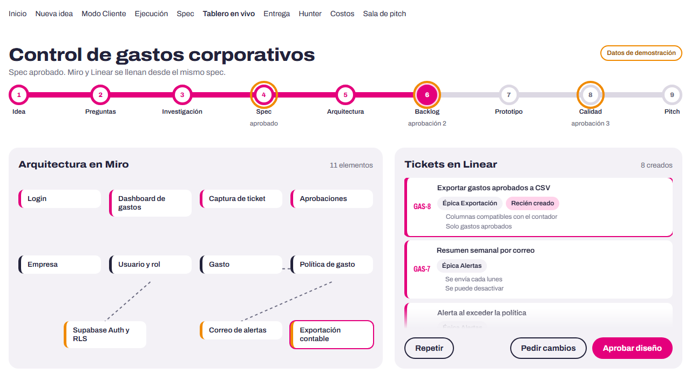

# SpeedHack

SpeedHack turns an idea into a research-backed specification, an architecture
board, a backlog, a prototype quality report, and a pitch with project-grounded
Q&A. A versioned spec carries context between stages, with three human approvals.
The product UI is in Spanish; this repository is the hackathon prototype.



The screenshot shows the application's recorded sample state (`demo_data: true`).
It is a real browser capture, not evidence of writes to external Miro or Linear.

## Run the no-key demo

Requirements: Python 3.12+, [uv](https://docs.astral.sh/uv/), Node.js 22+ and npm.
From a fresh checkout, in Git Bash, bash or a compatible shell:

```bash
uv sync --frozen
npm --prefix web ci
npm --prefix web run build
# In a UAK worktree, load its assigned port (never source a secrets file).
if [ -f .uak-env ]; then source .uak-env; fi
export UAK_PORT=${UAK_PORT:-8000}
DEMO_MODE=1 uv run uvicorn app.main:app --host 127.0.0.1 --port "$UAK_PORT"
```

Open `http://127.0.0.1:$UAK_PORT/` (substitute the printed/configured port).
For HACK-024 the assigned port is 8340. FastAPI serves both `/api` and the built
frontend, so this path avoids the development proxy's fixed backend port.
Health check: `curl "http://127.0.0.1:$UAK_PORT/api/health"`.
No `.env` file or provider keys are needed with `DEMO_MODE=1`.

Use **Tablero en vivo** (`/#/live-board`) to replay the architecture and backlog.
The execution, spec, delivery and client screens also have labeled samples.
Open **Sala de pitch** (`/#/pitch`) with the default run `demo-pitch` to ask about
the expense-control sample. Demo voice transcription is recorded and the bundled
audio is a placeholder; text input and written Q&A are the dependable fallback.
After dependencies and browser assets are installed, the recorded path needs no
provider connection; the first setup still needs package downloads.

Standalone screen fixtures are independent examples, not one continuous live
run. See the [three-minute script](docs/demo/script.md) for route conventions,
three explicit approvals, and a fallback at each step. The board wow starts at
00:55 and is scheduled to finish by 01:20.

- [Plan-B video and playback instructions](docs/demo/plan-b.md)
- [Clean-clone rehearsal evidence](docs/demo/rehearsal.md)
- Public deployment: **unverified / not supplied**. `render.yaml` and `Dockerfile`
  describe deployment, but do not establish that a public service exists. The
  submission owner must add and verify the judge-accessible URL before submission.

## Configuration

`.env.example` lists names only. Real values belong in an ignored `.env` or a
secret manager. Never commit them. Live mode (`DEMO_MODE=0`) needs the credentials
for each integration being exercised; a missing key is not a successful live call.

| Variables in `.env.example` | Purpose |
|---|---|
| `ANTHROPIC_API_KEY` | Structured LLM calls |
| `BACKBOARD_API_KEY` | Project memory |
| `ELEVENLABS_API_KEY`, `ELEVENLABS_VOICE_ID`, `ELEVENLABS_AGENT_ID` | Speech and conversational voice |
| `TAVILY_API_KEY`, `FIRECRAWL_API_KEY` | Research search and extraction |
| `MIRO_ACCESS_TOKEN` | Architecture board |
| `LINEAR_API_KEY`, `LINEAR_TEAM_ID` | Backlog issues |
| `LOVABLE_PREBUILT_URL` | Prebuilt prototype fallback |
| `N8N_WEBHOOK_URL`, `N8N_WEBHOOK_SECRET` | Human-approved outreach webhook |

Additional settings in `app/config.py`: `DEMO_MODE` defaults to true; `DATA_DIR`
defaults to `data`; `LLM_MODEL` pins the configured model. Model availability and
live provider access are not established by a successful recorded demo.

## Verify

```bash
bash .uak/bin/q bash -c 'test -s README.md && test -s docs/demo/script.md && bash .uak/bin/smoke'
```

Smoke runs design-lint, Python lint and tests, locked frontend installation,
frontend lint and a fresh production build. It does not prove that external
accounts or a public deployment work. To regenerate the actual screenshots and
the silent plan-B screen recording after starting the server:

```bash
uv run playwright install chromium
uv run python docs/demo/capture.py --base "http://127.0.0.1:$UAK_PORT"
```

## Data, licenses and limits

The barbershop, prospects and outbound messages are fictional (`demo_data: true`).
Outreach requires human approval, consent and an opt-out; the demo does not
establish production retention enforcement or legal compliance. Recorded research
is sample material: inspect its source URL and timestamp before using any figure.
Do not present fixture prices as current verified facts.

No project `LICENSE` file is currently present, so this repository does not grant
an open-source reuse license. Dependency licenses remain their respective owners'
terms; inspect installed package metadata and the lockfiles before redistribution.
External research pages and provider services retain their own rights and terms.
The screenshots and video document this repository's sample UI; they do not
license third-party source content. Submission forms, the event video limit,
public URL and license choice remain the human submission owner's responsibility.
